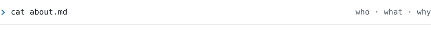
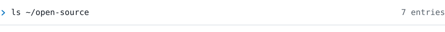
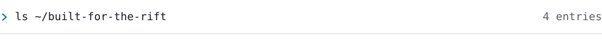
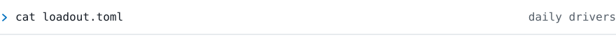
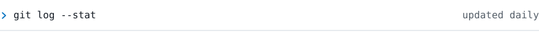

<picture>
  <source media="(prefers-color-scheme: dark)" srcset="./assets/hero-dark.svg" />
  <source media="(prefers-color-scheme: light)" srcset="./assets/hero-light.svg" />
  
</picture>

<p>
  <a href="https://ilkerbalcilar.com"><code>./website</code></a>&nbsp;
  <a href="https://ilkerbalcilar.com/blog"><code>./blog</code></a>&nbsp;
  <a href="https://www.linkedin.com/in/ilker-balcilar/"><code>./linkedin</code></a>&nbsp;
  <a href="https://www.npmjs.com/~jubstaa"><code>./npm</code></a>&nbsp;
  <a href="https://discordapp.com/users/225769737655681024"><code>./discord</code></a>&nbsp;
  <a href="mailto:ilkerbalcilartr@gmail.com"><code>./mail</code></a>
</p>

<br />

<picture>
  <source media="(prefers-color-scheme: dark)" srcset="./assets/section-about-dark.svg" />
  <source media="(prefers-color-scheme: light)" srcset="./assets/section-about-light.svg" />
  
</picture>

I build things from UI to infra: the frontend, the API, the data model, and the box it runs on. TypeScript end-to-end, Rust when a desktop app needs to feel native.

Most of my side projects start the same way. I notice a gap in something I use every day, usually League of Legends, a dev tool, or my own iPhone home screen, and I open the editor instead of shrugging it off.

<sub>CURRENTLY</sub>

→ software engineer at **Macellan SuperApp**<br />
→ bsc software engineering, İstanbul Nişantaşı<br />
→ maintaining **hono-telescope**, **tailwind-hitslop** and **standup-mr** on npm

<br />

<picture>
  <source media="(prefers-color-scheme: dark)" srcset="./assets/section-open-source-dark.svg" />
  <source media="(prefers-color-scheme: light)" srcset="./assets/section-open-source-light.svg" />
  
</picture>

<sub>DEVELOPER TOOL</sub><br />
**[hono-telescope](https://github.com/Jubstaaa/hono-telescope)** <sub>[npm ↗](https://www.npmjs.com/package/hono-telescope)</sub><br />
Laravel Telescope-style debugger for Hono, plus an MCP server so your AI agent can read live requests, exceptions and queries.<br />
<sub>`TypeScript` `Hono` `Bun` `MCP`</sub>

<sub>OPEN SOURCE LIBRARY</sub><br />
**[tailwind-hitslop](https://github.com/Jubstaaa/tailwind-hitslop)** <sub>[npm ↗](https://www.npmjs.com/package/tailwind-hitslop)</sub><br />
Invisible expanded tap targets for Tailwind v4, like React Native `hitSlop`. Pure CSS, zero JS.<br />
<sub>`Tailwind CSS` `CSS` `TypeScript`</sub>

<sub>DEVELOPER TOOL</sub><br />
**[standup-mr](https://github.com/Jubstaaa/standup-mr)** <sub>[npm ↗](https://www.npmjs.com/package/standup-mr)</sub><br />
Standup notes from merge request state, not commit logs. CLI + hosted OAuth MCP for GitLab and GitHub.<br />
<sub>`TypeScript` `MCP` `OAuth 2.1` `SQLite`</sub>

<sub>DESKTOP APP</sub><br />
**[IconState](https://github.com/Jubstaaa/iconstate)** <sub>[release ↗](https://github.com/Jubstaaa/iconstate/releases/latest)</sub><br />
Rearrange your iPhone home screen from your Mac. Drag icons and folders with a mouse, over USB.<br />
<sub>`Tauri` `Rust` `React`</sub>

<sub>GITHUB ACTION</sub><br />
**[auto-watch](https://github.com/Jubstaaa/auto-watch)** <sub>[marketplace ↗](https://github.com/marketplace/actions/auto-watch-repositories)</sub><br />
Watches every repo you create, the way GitHub used to before 2025.<br />
<sub>`TypeScript` `GitHub Actions`</sub>

<sub>BROWSER EXTENSION</sub><br />
**[FontMapper](https://github.com/Jubstaaa/font-mapper)** <sub>[chrome web store ↗](https://chromewebstore.google.com/detail/gfdmhpidmomcbghfoejkcpjdklbdcdnn)</sub><br />
Swaps any site's fonts for the ones installed on your machine, per domain.<br />
<sub>`React` `TypeScript` `Chrome MV3`</sub>

<sub>NEWSLETTER</sub><br />
**[brief](https://github.com/Jubstaaa/brief)** <sub>[brief.ilkerbalcilar.com ↗](https://brief.ilkerbalcilar.com)</sub><br />
Weekly digest of what changed in React and Next.js, read from the commits, not the release notes.<br />
<sub>`Next.js` `Bun` `GitHub Actions`</sub>

<br />

<picture>
  <source media="(prefers-color-scheme: dark)" srcset="./assets/section-rift-dark.svg" />
  <source media="(prefers-color-scheme: light)" srcset="./assets/section-rift-light.svg" />
  
</picture>

> I hit Challenger as a jungle main. At that level you stop seeing the game and start seeing the gaps. [Why I keep building League tools ↗](https://ilkerbalcilar.com/blog/why-i-keep-building-league-of-legends-tools)

<sub>STREAMING TOOL</sub><br />
**[StatBox](https://statbox.live)** — free OBS browser-source widget: live rank, recent games and session stats for streamers.

<sub>DESKTOP APP</sub><br />
**[LoL Config Editor](https://github.com/Jubstaaa/lol-config-editor)** — edit League settings without launching the game, save profiles, swap Riot accounts in one click.

<sub>AUTOMATION</sub><br />
**[Daily Lore Bot](https://www.instagram.com/daily.league.lore/)** — picks a champion, pulls the lore, narrates it with AI and posts a video to Instagram every day.

<sub>WEB + MOBILE GAME</sub><br />
**[Pixel Guess](https://pixelguessgame.com)** — guess the champion as it un-pixelates. One monorepo, global leaderboard.

<br />

<picture>
  <source media="(prefers-color-scheme: dark)" srcset="./assets/section-loadout-dark.svg" />
  <source media="(prefers-color-scheme: light)" srcset="./assets/section-loadout-light.svg" />
  
</picture>

```toml
[player]
name     = "İlker Balcılar"
class    = "full-stack engineer"
guild    = "@macellan"
base     = "Istanbul, TR"
rift     = "Challenger · jungle main"

[loadout]
main     = "TypeScript"
frontend = ["Next.js", "React", "React Native", "Expo", "Tailwind"]
backend  = ["Hono", "Bun", "Node.js", "Payload CMS", "Prisma"]
desktop  = ["Tauri", "Rust", "Electron"]
infra    = ["Cloudflare Workers", "DigitalOcean", "Docker", "Caddy", "GitHub Actions"]
data     = ["PostgreSQL", "SQLite", "MongoDB", "Redis"]
tools    = ["Zed", "Claude Code", "Figma"]
```

<br />

<picture>
  <source media="(prefers-color-scheme: dark)" srcset="./assets/section-stats-dark.svg" />
  <source media="(prefers-color-scheme: light)" srcset="./assets/section-stats-light.svg" />
  
</picture>

<p>
  
  
</p>

<picture>
  <source media="(prefers-color-scheme: dark)" srcset="https://raw.githubusercontent.com/Jubstaaa/Jubstaaa/output/github-snake-dark.svg" />
  
</picture>

<br />

<picture>
  <source media="(prefers-color-scheme: dark)" srcset="./assets/section-blog-dark.svg" />
  <source media="(prefers-color-scheme: light)" srcset="./assets/section-blog-light.svg" />
  
</picture>

<!-- BLOG-POST-LIST:START -->
- [Where X Keeps Your Decrypted DMs &lpar;and How I Built an Exporter Around It&rpar;](https://ilkerbalcilar.com/blog/where-x-keeps-your-decrypted-dms) <sub>Oct 26, 2026</sub>
- [A Dozen Apps on One Small Droplet: My Self-Hosting Setup](https://ilkerbalcilar.com/blog/a-dozen-apps-on-one-small-droplet) <sub>Oct 19, 2026</sub>
- [Why I Keep Building League of Legends Tools](https://ilkerbalcilar.com/blog/why-i-keep-building-league-of-legends-tools) <sub>Jul 10, 2026</sub>
- [Hit-Slop for the Web: Bigger Tap Targets in Tailwind CSS](https://ilkerbalcilar.com/blog/hit-slop-for-the-web-bigger-tap-targets-in-tailwind) <sub>Jun 7, 2026</sub>
- [How to Debug Hono Applications with Telescope — Laravel Telescope for Bun &amp; Node.js](https://ilkerbalcilar.com/blog/how-to-debug-hono-applications-with-hono-telescope) <sub>Oct 31, 2025</sub><!-- BLOG-POST-LIST:END -->

<br />

<sub>ilker balcilar · istanbul · <a href="https://ilkerbalcilar.com">ilkerbalcilar.com ↗</a></sub>
